<p align="center">
  
</p>

<h1 align="center">Tabaa · طابع</h1>

<p align="center">
  <strong>Logiciel de facturation électronique pour le Maroc.</strong><br>
  Factures conformes (ICE, IF, RC, TVA), encaissements, UBL 2.1, en français et en arabe.<br>
  Conçu pour la réforme de la facture électronique de la DGI.
</p>

<p align="center">
  <strong><a href="https://abderrahimghazali.github.io/facturation-electronique-maroc/">Où en est la réforme ? Le point à jour, daté et sourcé →</a></strong>
</p>

<p align="center">
  Outils gratuits :
  <a href="https://abderrahimghazali.github.io/outils/verificateur-ice/">vérificateur d'ICE</a> ·
  <a href="https://abderrahimghazali.github.io/outils/generateur-ubl/">générateur de facture UBL 2.1</a>
</p>

<p align="center">
  <a href="#fonctionnalités">Fonctionnalités</a> ·
  <a href="#conformité-marocaine">Conformité</a> ·
  <a href="#architecture">Architecture</a> ·
  <a href="#démarrer">Démarrer</a> ·
  <a href="#sécurité">Sécurité</a> ·
  <a href="#feuille-de-route">Feuille de route</a> ·
  <a href="#english">English</a> ·
  <a href="#العربية">العربية</a>
</p>

<p align="center">
  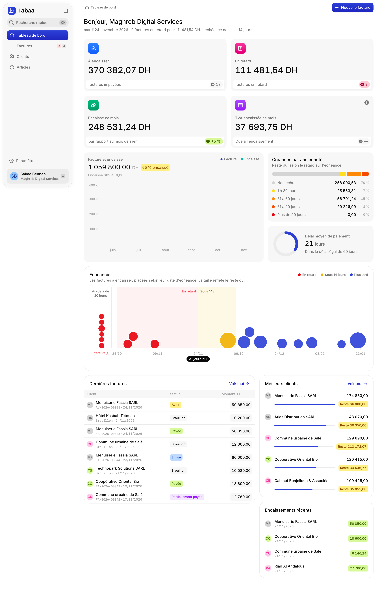
</p>

---

## Pourquoi Tabaa

Le Maroc prépare la généralisation de la **facture électronique** : chaque facture sera transmise à une plateforme de la Direction Générale des Impôts (DGI), validée, puis remise au client, au format structuré **UBL 2.1**. La base légale existe (article 145-IX du Code Général des Impôts) ; le décret d'application et les spécifications techniques ne sont pas encore publiés. L'état de la réforme est suivi sur [une page dédiée](https://abderrahimghazali.github.io/facturation-electronique-maroc/), mise à jour à chaque évolution.

Tabaa (طابع, « le cachet ») est un logiciel de facturation pensé pour cette transition :

- il produit dès aujourd'hui des factures **complètes au regard du droit marocain** ;
- il conserve chaque facture sous forme **structurée**, avec une sortie UBL 2.1 ;
- il suit les **encaissements**, parce qu'au Maroc la TVA est due à l'encaissement ;
- il isole le raccordement à la DGI derrière un connecteur, à écrire dès la publication des spécifications.

> **État du projet.** Tabaa est un projet en développement actif. Il **n'est pas raccordé à la DGI** et **ne dispose d'aucun agrément ni d'aucune certification** : aucun dispositif d'agrément des logiciels de facturation n'a été publié à ce jour. Les valeurs réglementaires (taux, délais, seuils) sont à faire valider par un expert-comptable avant tout usage réel.

## Fonctionnalités

| | |
|---|---|
| **Factures** | Brouillon avec aperçu A4 en direct, émission avec numérotation continue (`FA-2026-00001`), avoirs, acomptes |
| **Immuabilité** | Une facture émise ne peut plus être modifiée : la base de données elle-même refuse la modification |
| **Mentions légales** | ICE, IF, RC et tribunal, taxe professionnelle, CNSS, montant en toutes lettres en français et en arabe |
| **Contrôles avant émission** | ICE du client obligatoire pour une entreprise, cohérence des totaux, taux de TVA autorisés, échéance |
| **Encaissements** | Paiements partiels, statut payé / partiellement payé / en retard, TVA encaissée du mois |
| **Tableau de bord** | Créances par ancienneté, facturé et encaissé sur six mois, délai moyen de paiement, échéancier |
| **PDF** | Téléchargement en PDF, identique à l'écran, texte sélectionnable et arabe compris ; le fichier d'une facture émise est généré une fois, conservé avec son empreinte et ne change plus |
| **UBL 2.1** | Export XML de chaque facture émise |
| **Envoi par e-mail** | Envoi de la facture au client avec le PDF et, au choix, le fichier UBL ; relances ; historique des envois |
| **Banque** | Import d'un relevé bancaire (CSV, lu dans le navigateur), rapprochement des virements reçus avec les factures, suggestions par numéro, montant ou nom |
| **Achats** | Factures fournisseurs par taux de TVA, validation par un propriétaire ou un administrateur, paiements, contrôles (ICE, délai, plafond des espèces) |
| **Retenue à la source** | Sur les paiements reçus et versés : TVA retenue et retenue sur honoraires, qui soldent la facture sans être une remise |
| **Déclarations** | États préparatoires : TVA (collectée, déductible, relevé de déductions), retenues à la source, délais de paiement (loi 69-21), avec export CSV et impression |
| **Équipe** | Invitations, cinq rôles dont expert-comptable en lecture seule, plusieurs espaces par personne |
| **Clients et catalogue** | Fiche client avec encours, articles et services avec taux de TVA |
| **Comptes et espaces** | Inscription avec vérification de l'e-mail, double authentification, réinitialisation du mot de passe ; un espace isolé par entreprise, avec rôles |
| **Deux langues** | Interface en français et en arabe, avec mise en page de droite à gauche |

<p align="center">
  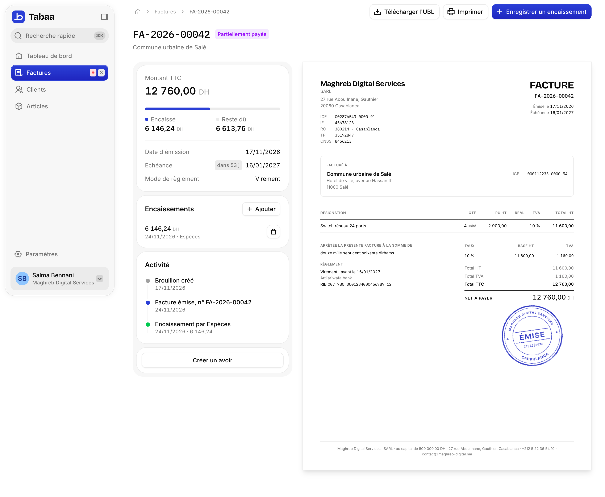
</p>

<table>
  <tr>
    <td width="50%">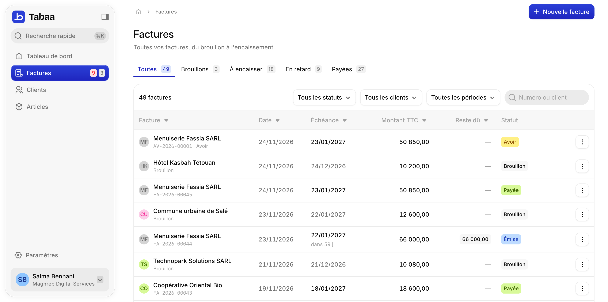</td>
    <td width="50%">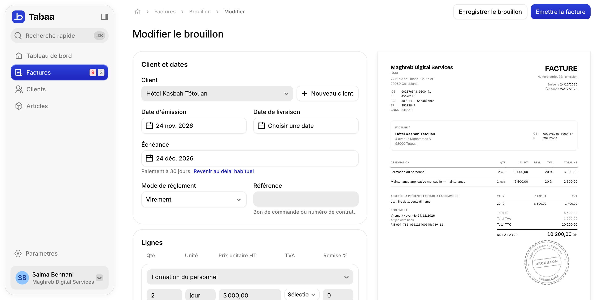</td>
  </tr>
  <tr>
    <td align="center"><sub>Liste des factures</sub></td>
    <td align="center"><sub>Éditeur avec aperçu en direct</sub></td>
  </tr>
</table>

<table>
  <tr>
    <td width="50%" valign="top">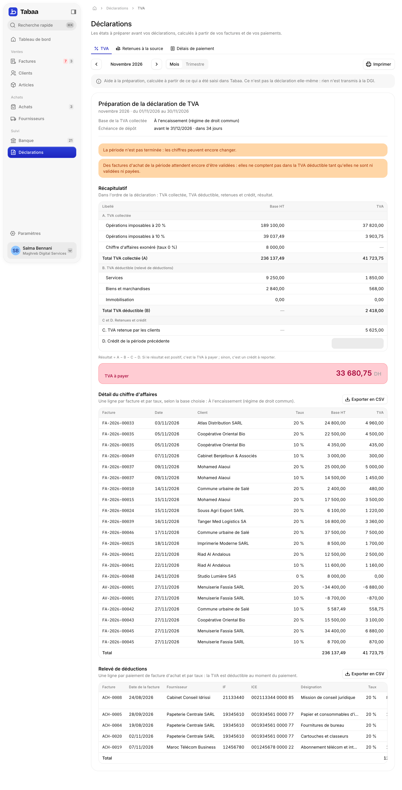</td>
    <td width="50%" valign="top">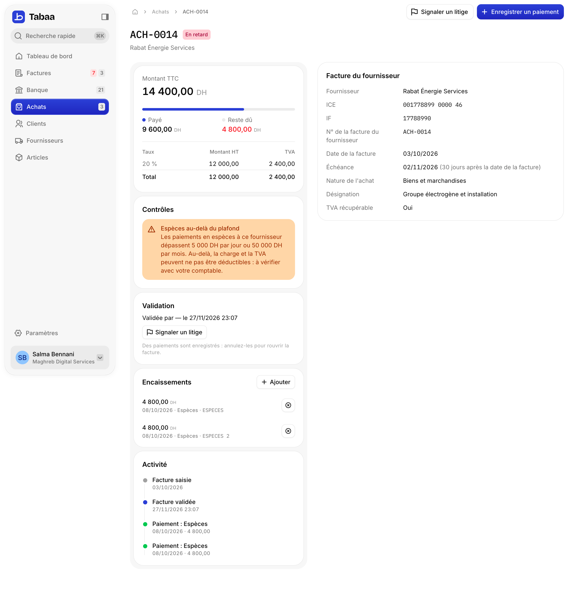</td>
  </tr>
  <tr>
    <td align="center"><sub>Préparation de la déclaration de TVA</sub></td>
    <td align="center"><sub>Facture d'achat</sub></td>
  </tr>
</table>

> Les états de la rubrique Déclarations sont des aides à la préparation. Ils ne sont pas des déclarations, rien n'est transmis à la DGI, et les règles de calcul (en particulier l'amende de la loi 69-21 et l'historique du taux directeur) sont à faire confirmer par un expert-comptable.

<p align="center">
  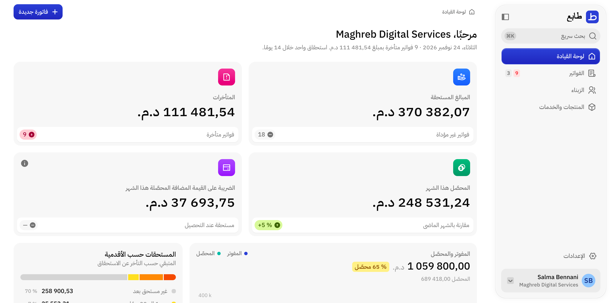<br>
  <sub>La même interface en arabe</sub>
</p>

## Conformité marocaine

| Exigence | Référence | État dans Tabaa |
|---|---|---|
| Mentions obligatoires sur la facture | CGI art. 145 | Fait |
| ICE du vendeur et du client | CGI art. 145 | Fait (contrôle de longueur ; clé de contrôle à vérifier) |
| Numérotation continue | CGI art. 145-III | Fait |
| TVA à l'encaissement | CGI | Suivi des encaissements fait ; préparation de la déclaration prévue |
| Droit de timbre sur paiement en espèces | CGI | Fait (taux à valider) |
| Délais de paiement | Loi 69-21 | Échéance par défaut et alerte faites ; déclaration prévue |
| Format structuré | UBL 2.1 | Fait (profil marocain en attente de publication) |
| Retenue à la source de TVA | CGI art. 117 | Prévu |
| Relevé de déductions de TVA | SIMPL-TVA | Prévu |
| Conservation dix ans | CGI art. 211 | Prévu (archivage scellé) |
| Transmission à la plateforme DGI | CGI art. 145-IX | En attente des spécifications |

### Le circuit visé par la réforme

Ce schéma décrit le fonctionnement annoncé. Il reste à confirmer par les textes.

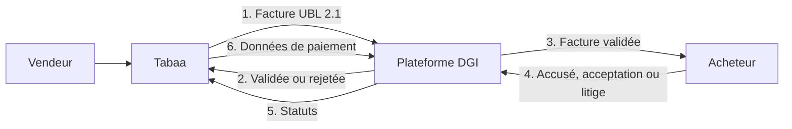

### Le cycle de vie d'une facture

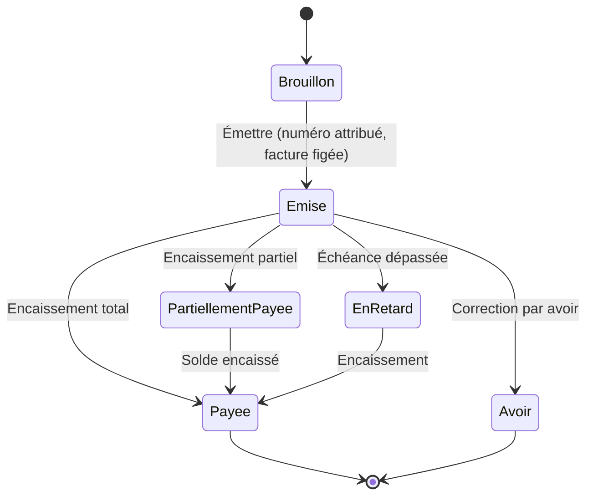

## Architecture

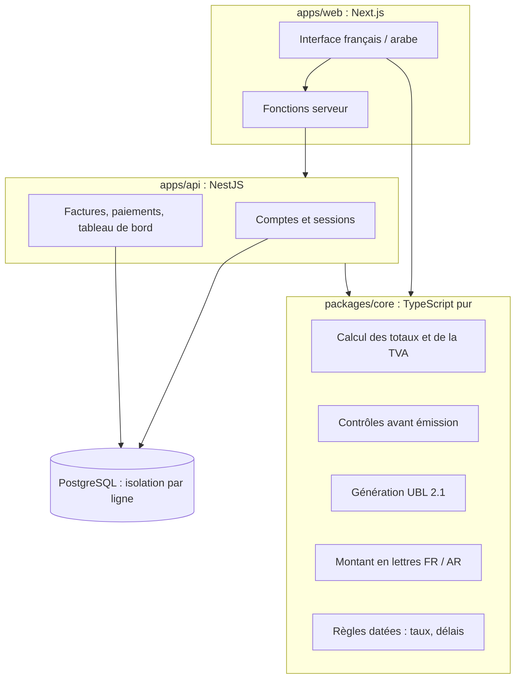

- **Un seul modèle de facture.** L'aperçu à l'écran, les contrôles, le calcul et l'UBL partent des mêmes données et du même code (`packages/core`).
- **Les règles sont des données.** Taux de TVA, délais légaux et droit de timbre vivent dans un fichier de règles daté, pas dans la logique.
- **Isolation des entreprises dans la base.** Chaque table porte l'identifiant de l'espace et PostgreSQL applique la sécurité au niveau des lignes. Les données de connexion sont lues par un rôle de base distinct.
- **Montants sans virgule flottante.** Décimaux de bout en bout.

| Couche | Choix |
|---|---|
| Interface | Next.js, React, Tailwind CSS, React Aria |
| API | NestJS, validation par schémas Zod partagés |
| Données | PostgreSQL, Drizzle ORM, sécurité au niveau des lignes |
| Domaine | TypeScript pur, testé avec Vitest |
| Outillage | pnpm, Turborepo, Docker pour la base |

## Démarrer

Prérequis : Node.js 22, pnpm 10, Docker.

```bash
git clone https://github.com/abderrahimghazali/tabaa.git
cd tabaa
pnpm install
cp .env.example .env            # puis remplacer les valeurs « change-me » par des valeurs aléatoires

pnpm db:up                      # PostgreSQL, Redis et une boîte e-mail locale
pnpm --filter @facture/core build
pnpm --filter api db:migrate
pnpm --filter api db:seed       # données de démonstration
pnpm --filter web pdf:install   # navigateur Chromium pour la génération des PDF

pnpm dev                        # interface sur http://localhost:3100, API sur http://localhost:4100
```

Comptes de démonstration créés par le jeu de données, mot de passe `tabaa-demo-2026` : `demo@tabaa.ma` (propriétaire), `membre@tabaa.ma` (membre), `comptable@tabaa.ma` (expert-comptable), `lecteur@tabaa.ma` (lecture seule).

En développement, tous les e-mails envoyés (vérification, réinitialisation, alertes) arrivent dans la boîte locale : http://localhost:8125.

```bash
pnpm --filter @facture/core test   # logique métier
pnpm --filter api test:e2e         # API, sur la base réelle
```

Le contrat HTTP est décrit dans [`API.md`](API.md).

## Sécurité

Tabaa traite des pièces comptables, des identifiants fiscaux et des données personnelles. Les mesures techniques suivantes sont en place et couvertes par des tests automatisés ; elles suivent les contrôles techniques de l'annexe A de la norme ISO/IEC 27001:2022.

| Domaine | Mesure |
|---|---|
| Cloisonnement | Sécurité au niveau des lignes forcée sur chaque table d'un espace ; un test échoue si une table en est dépourvue |
| Moindre privilège | Trois rôles de base de données distincts : migrations, requêtes métier, authentification. Le rôle métier ne peut pas lire les comptes ni les sessions |
| Authentification | Mots de passe hachés avec scrypt, double authentification par application (TOTP) avec codes de secours, e-mail vérifié à l'inscription, sessions côté serveur révocables, cookie `HttpOnly`, `Secure`, `SameSite=Lax`, expiration après 8 heures d'inactivité et 14 jours au plus, déconnexion de tous les appareils |
| Contrôle d'accès | Rôles propriétaire, administrateur, membre, lecteur, vérifiés par l'API |
| Journal d'activité | Journal en ajout seul des connexions, refus d'accès et modifications ; la base rejette toute modification ou suppression d'une entrée |
| Intégrité des pièces | Facture émise figée avec les coordonnées du vendeur et du client ; encaissements annulés, jamais supprimés |
| Suppression et conservation | Export des données par le propriétaire ; fermeture de l'espace avec suppression des comptes et des brouillons, conservation verrouillée des factures émises pendant la durée légale, puis purge automatique |
| Non-divulgation | Réponses identiques à l'inscription, à la connexion et à la réinitialisation, que le compte existe ou non |
| Protection du web | Politique de sécurité du contenu avec nonce, en-têtes de sécurité, vérification de l'origine des requêtes, limitation du nombre de tentatives de connexion |
| Entrées | Validation par schéma de chaque requête, tailles bornées, requêtes SQL paramétrées |
| Configuration | Aucun secret dans le dépôt ; l'API refuse de démarrer si un réglage requis manque |
| Chaîne logicielle | Versions verrouillées, audit des dépendances, analyse CodeQL et mises à jour Dependabot à chaque modification |

> Tabaa **n'est pas certifié ISO 27001**. Cette norme certifie le système de management de la sécurité d'une organisation, à l'issue d'un audit ; aucun logiciel ne peut l'être par son seul code. Restent à la charge de l'exploitant, notamment : un fournisseur d'e-mail (SMTP), les sauvegardes et leur restauration, le chiffrement et le TLS de l'hébergement, la gestion des secrets, la supervision, et les démarches auprès de la CNDP (loi 09-08).

Pour signaler une faille, voir [`SECURITY.md`](SECURITY.md).

## Feuille de route

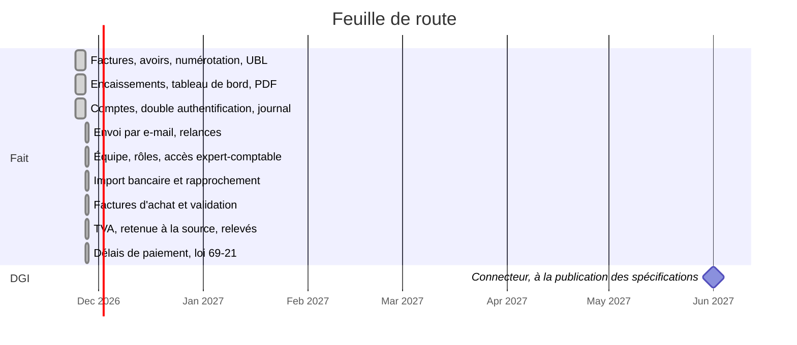

Les dates sont indicatives. Le connecteur DGI dépend de la publication des spécifications, pas d'une date.

## Questions fréquentes

**La facture électronique est-elle obligatoire au Maroc ?**
Le principe est inscrit dans le Code Général des Impôts (article 145-IX). Sa mise en œuvre attend un décret d'application, qui n'était pas publié au Bulletin officiel en novembre 2026. Le déploiement annoncé est progressif, en commençant par les grandes entreprises.

**Quel format de facture électronique la DGI a-t-elle retenu ?**
Les annonces mentionnent le XML UBL 2.1. Le profil marocain détaillé n'est pas publié. Tabaa produit de l'UBL 2.1 et adaptera son profil dès la publication.

**Qu'est-ce que l'ICE ?**
L'Identifiant Commun de l'Entreprise, un numéro de quinze chiffres. Il doit figurer sur les factures, pour le vendeur comme pour le client professionnel.

**Tabaa est-il agréé par l'État ?**
Non. Aucun dispositif d'agrément ou de certification des logiciels de facturation n'a été publié à ce jour. Tabaa suivra la procédure dès qu'elle existera.

**Tabaa remplace-t-il un expert-comptable ?**
Non. Il prépare et structure les données ; les règles fiscales appliquées doivent être validées par un professionnel.

## English

Tabaa is an e-invoicing application for Morocco. It issues invoices that carry the Moroccan mandatory mentions (ICE, IF, RC, VAT), locks them once issued, tracks payments (Moroccan VAT is due on receipt), exports UBL 2.1, and runs in French and Arabic with right-to-left layout.

Morocco's e-invoicing mandate has a legal basis but its implementing decree and technical specifications are not yet published. Tabaa is **not connected to the tax administration's platform and holds no state approval**; the DGI connector will be written when the specification is released.

## العربية

«طابع» برنامج للفوترة الإلكترونية بالمغرب: فواتير تتضمن البيانات الإلزامية (التعريف الموحد للمقاولة، التعريف الضريبي، السجل التجاري، الضريبة على القيمة المضافة)، تتبّع التحصيلات، وتصدير بصيغة UBL 2.1، بواجهة عربية وفرنسية.

المشروع قيد التطوير، وهو غير مرتبط بمنصة المديرية العامة للضرائب ولا يتوفر على أي اعتماد رسمي إلى حدود اليوم.

## Marque

Le logo, ses variantes et l'animation de chargement sont dans [`brand/`](brand/).

## Licence

Tabaa est distribué sous licence [GNU Affero General Public License v3.0](LICENSE). Vous pouvez l'utiliser, le modifier et le redistribuer ; si vous exploitez une version modifiée comme service en ligne, vous devez en publier le code source sous la même licence.

Copyright © 2026 Abderrahim Ghazali.

Les notices des composants tiers sont dans [`THIRD_PARTY_NOTICES.md`](THIRD_PARTY_NOTICES.md).
