# Technical Specification: Moroccan E-Invoicing Platform ("Tabaa")

| | |
|---|---|
| Status | Draft v1 |
| Date | 24 November 2026 |
| Country | Morocco (DGI, Direction Générale des Impôts) |

**Confidence markers.** Moroccan e-invoicing is announced but its detailed rules are not published. Every statement in this document carries one of three levels:

- **[LAW]** current Moroccan rule, in force today.
- **[ANNOUNCED]** stated publicly by the DGI or reported consistently by several sources, but not yet in a published decree or specification. Design for it, do not hard-code it.
- **[V]** to verify against the official text before implementation (list in section 24).

---

## 1. The situation in Morocco, and what it means for the product

### 1.1 Status of the mandate (November 2026)

| Item | Status |
|---|---|
| Legal basis | CGI art. 145-IX, introduced by the 2018 finance law: taxpayers must use an invoicing system meeting criteria set by the administration **[LAW]**, details left to regulation |
| Implementing decree | **Not published.** A draft was sent to the Secrétariat Général du Gouvernement in April 2026; still absent from the Bulletin Officiel in October 2026 **[ANNOUNCED]** |
| DGI platform | Reported as built, tested and accepted (developed by xHub) **[ANNOUNCED]** |
| Technical specifications, API, sandbox | **None published** |
| Model | Centralised clearance: the invoice goes to the DGI platform, is validated, then reaches the buyer **[ANNOUNCED]** |
| Format | UBL 2.1 XML; CII also cited by some sources **[ANNOUNCED]** |
| Scope and phasing | B2B first, large companies first (turnover above 200 M MAD is the figure most cited); SMEs and micro-businesses later, 2027-2028 provisional; B2C later **[ANNOUNCED]** |
| Access channels | Free DGI web portal for small businesses, system-to-system connection for ERPs, certified service providers in a later phase **[ANNOUNCED]** |
| Penalties specific to e-invoicing | Not published; figures circulating online contradict each other |

### 1.2 Consequences for what we build

1. **The product cannot depend on the mandate to be useful.** SMEs may not be obliged before 2027-2028. The app must earn its place on obligations that already exist: legally complete invoices, VAT on receipts, payment-terms law 69-21, withholding of VAT, VAT deduction statements, 10-year archive.
2. **The DGI connection is an adapter with an unknown contract.** We define our own internal interface now and implement the real one when the specification is published. Until then, a simulator.
3. **Everything the DGI is likely to demand is prepared in advance**: structured canonical data, UBL 2.1 output, validated identifiers, immutable numbering, signature capability, status tracking.
4. **A rules-as-data design** so that thresholds, dates, code lists and validation rules can change without a release.

### 1.3 Scope

A multi-tenant SaaS for Moroccan companies and their accountants (fiduciaires, experts-comptables):

- sales invoicing compliant with the CGI and commercial law;
- purchase invoice capture, checking, approval and payment;
- VAT tracking on the receipts basis, withholding at source;
- payment-terms compliance (law 69-21) and its declaration;
- tax exports (VAT deduction statement, customer and supplier statements);
- legal archive;
- DGI clearance as soon as it opens.

Out of scope for v1: full general ledger, payroll, point of sale, becoming a certified service provider.

### 1.4 Assumptions

1. Target: TPE/PME, auto-entrepreneurs and accounting firms, with a later move up to mid-size companies.
2. Interface languages: French and Arabic (right-to-left), English optional.
3. Currency MAD; foreign-currency invoices supported with MAD equivalent.
4. Hosting in Morocco preferred (section 19).

---

## 2. Regulatory baseline in force today

### 2.1 Mandatory invoice content

| Mention | Source | Note |
|---|---|---|
| Seller identity, legal form, capital, registered office | Commercial law **[LAW]** | |
| **ICE** of the seller (Identifiant Commun de l'Entreprise) | CGI art. 145-VIII **[LAW]** | 15 digits: 9 company + 4 establishment (0000 = head office) + 2 check digits |
| **ICE of the customer** for business customers | CGI art. 145 **[LAW]** | Missing customer ICE puts the buyer's deduction at risk |
| **IF** (Identifiant Fiscal) | CGI art. 145-III **[LAW]** | |
| **Taxe professionnelle** number (patente) | CGI art. 145-III **[LAW]** | |
| **RC** number and court | Commercial law **[LAW]** | |
| **CNSS** number | Customary, expected on invoices **[V]** | |
| Invoice number from a continuous series | CGI art. 145-III **[LAW]** | Pre-numbered or generated by an unbroken software sequence |
| Date of the operation | CGI art. 145-III **[LAW]** | |
| Customer name and address | CGI art. 145-III **[LAW]** | |
| Nature, quantity and unit price of goods or services | CGI art. 145-III **[LAW]** | |
| VAT amount shown separately, with rate; or exemption reference | CGI art. 145-III **[LAW]** | |
| Payment references and method | CGI art. 145-III **[LAW]** | |
| Amount in words ("Arrêtée la présente facture à la somme de ...") | Customary **[V]** | Generated in French and Arabic |
| Payment term and late-payment conditions | Law 69-21 **[LAW]** | |

Penalty for a missing or wrong mention: reported as 100 MAD per omission (CGI art. 198 ter) **[V]**.

### 2.2 VAT

| Topic | Rule |
|---|---|
| Rates | Two rates since the 2024-2026 reform completed: **20%** standard, **10%** reduced; plus exemptions with or without right of deduction **[V]** exact product mapping |
| Tax point | **Receipt of payment** by default (régime de l'encaissement); option for the debit basis **[LAW]** |
| Filing | Monthly or quarterly depending on turnover, on SIMPL-TVA **[LAW]** |
| Deduction statement | The VAT return carries a detailed list of purchase invoices (supplier IF and ICE, invoice number, amounts, payment date and method), filed electronically **[LAW]**, exact schema **[V]** |
| Withholding at source of VAT | CGI art. 117: the payer withholds **75%** of the VAT when the supplier presents a valid tax-compliance certificate (attestation de régularité fiscale), **100%** without it; scope extended by the 2026 finance law, including to the private sector and to rents **[V]** exact scope, payer categories and certificate validity |
| Non-resident digital services | Separate 100% withholding mechanism **[V]** |
| Auto-entrepreneurs | Not subject to VAT; specific mention on the invoice **[V]** |

**Product consequence:** because VAT is normally due when cash is received, **payment tracking is a tax function, not a convenience**. Every receipt and payment must be dated, allocated to invoices and split by VAT rate.

### 2.3 Payment terms: law 69-21

| Topic | Rule |
|---|---|
| Legal term | 60 days from the invoice date by default; up to 120 days by agreement; specific sectors up to 180 **[V]** |
| Invoice timing | The invoice must be issued by the end of the month of delivery; otherwise the clock starts from that date **[V]** |
| Fine | Pecuniary fine on amounts paid late, paid to the Treasury, based on the central bank key rate for the first month plus a supplement per additional month **[V]** |
| Declaration | Electronic declaration to the DGI of invoices paid late or unpaid; quarterly or annual according to turnover **[V]** (sources disagree on the 2-10 M MAD band) |
| Scope | Companies with turnover from 2 M MAD excl. VAT; no sector exclusion (DGI position, March 2026) **[V]** |
| Penalties for the declaration | 5,000 MAD per missing or inaccurate invoice in an incomplete declaration; fixed fines from 5,000 to 250,000 MAD for late or missing declaration **[V]** |

### 2.4 Other rules that shape the product

| Rule | Effect |
|---|---|
| Record keeping 10 years (CGI art. 211, accounting law 9-88) **[LAW]** | Archive retention |
| Cash payments: stamp duty (droit de timbre de quittance) of 0.25% on cash-settled invoices; deductibility of cash-paid expenses is capped **[V]** | Payment method drives a tax line and a warning |
| Law 43-20 on trust services **[LAW]**: simple, advanced and qualified signatures and seals; Barid eSign approved by the DGSSI for qualified certificates | Signature and seal provider |
| Law 09-08 on personal data **[LAW]**: CNDP formalities; transfer of personal data abroad without authorisation is an offence | Hosting and sub-processors |
| Law 05-20 on cybersecurity **[LAW]** | Security baseline, relevant for sensitive customers |
| Public sector: suppliers deposit invoices electronically on the Treasury's GID platform **[V]** | B2G channel, separate from DGI clearance |

---

## 3. Target flow under DGI clearance

Everything in this section is **[ANNOUNCED]**. It is the design hypothesis.

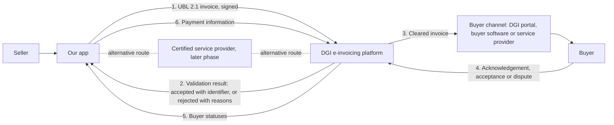

Open questions that the specification must answer, each mapped to a design provision:

| Unknown | Provision in our design |
|---|---|
| Synchronous or asynchronous validation | Submission is always a queued job; UI shows "awaiting DGI" |
| Identifier returned (number, hash, QR code) | `clearance_id`, `clearance_hash`, `clearance_qr` columns, nullable; invoice template has a reserved zone |
| Signature required from the seller, and at what level | Signing step is a pluggable stage: none / seal with qualified certificate (law 43-20) |
| Who delivers to the buyer | Delivery module supports "DGI delivers", "we deliver after clearance", "both" |
| Buyer response statuses | Generic status model (section 11) with a mapping table |
| Payment reporting | Payments already tracked per invoice and per VAT rate |
| Credit notes and corrections | Always linked to the original invoice; never edit a cleared invoice |
| Offline / platform unavailable procedure | Contingency queue with timestamps and proof of attempts |
| Morocco-specific UBL profile (extensions, code lists) | Profile is a versioned data package, not code |
| B2C, exports, self-billing | Classifier (section 9) routes them; rules are data |

---

## 4. Functional map

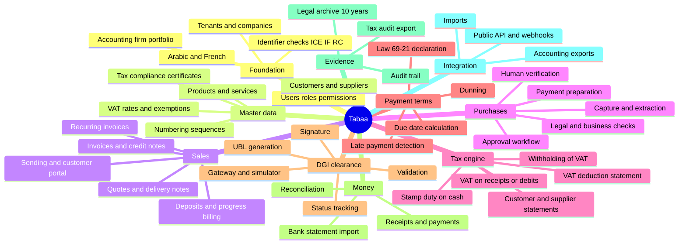


---

## 5. Architecture

### 5.1 Principles

1. **Modular monolith** in TypeScript. No microservices.
2. **One canonical invoice model**, aligned on the UBL 2.1 / EN 16931 semantic model, with a Moroccan extension block. UBL, PDF and exports are projections.
3. **Issued invoices are immutable**; corrections are credit notes.
4. **Regulated rules are data**: VAT rates, withholding rates, legal payment terms, thresholds, code lists and validation rules live in versioned rule packages with effective dates.
5. **DGI independence**: a `ClearanceGateway` port with three implementations: simulator, DGI direct, service provider.
6. **Transactional outbox** and idempotent jobs for every external call.
7. **Tenant isolation in the database** (row-level security).

### 5.2 System context

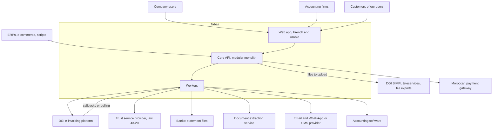

### 5.3 Containers

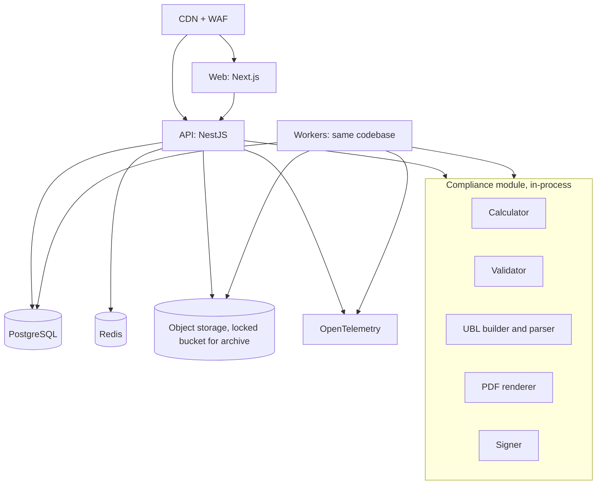

### 5.4 Modules

| Module | Responsibility |
|---|---|
| `identity` | Tenants, users, roles, MFA, API keys |
| `company` | Legal entities, establishments, identifiers, VAT regime, turnover band |
| `parties` | Customers, suppliers, identifier validation, tax-compliance certificates |
| `catalog` | Items, units, VAT rates, exemption codes |
| `sales` | Quotes, delivery notes, invoices, credit notes, numbering |
| `purchases` | Capture, extraction, verification, matching |
| `tax` | VAT tax point, withholding, stamp duty, statements |
| `payment-terms` | Due dates, lateness, fines estimate, law 69-21 declaration |
| `clearance` | UBL, signature, gateway, statuses |
| `payments` | Receipts, payments, allocations, bank reconciliation |
| `workflow` | Rules, tasks, queues |
| `archive` | Sealing, retention, export |
| `rules` | Versioned rule packages |
| `notifications`, `reporting`, `integrations`, `billing`, `audit` | Support modules |

---

## 6. Recommended stack

**TypeScript end to end, one deployable, PostgreSQL.**

This differs from the French spec, which added a JVM service. That service was justified by French requirements (PDF/A-3 Factur-X, published Schematron rule sets). Morocco has announced UBL XML and published no validation artefacts, so a second runtime would be speculative. The compliance module sits behind an interface; if the DGI specification later requires tooling that only exists on the JVM, that module can be extracted without touching the rest.

| Layer | Choice | Why |
|---|---|---|
| Monorepo | pnpm + Turborepo | Shared types across web, API, SDK |
| Web | Next.js, React, TypeScript | Mature, good RTL support |
| UI | Tailwind (logical properties for RTL), shadcn/ui, TanStack Table and Query, React Hook Form, Zod | Dense finance screens, shared validation |
| i18n | next-intl or equivalent, ICU messages | French, Arabic, number-to-words in both |
| API | Node LTS, NestJS on Fastify, REST + OpenAPI 3.1 | Module boundaries, generated contract |
| Database | PostgreSQL with row-level security, Drizzle | Integrity, tenant isolation |
| Jobs | pg-boss + transactional outbox | Jobs commit with business data; one less system |
| Cache | Redis | Sessions, rate limits |
| Storage | S3-compatible with object lock | Immutable archive |
| UBL | Typed builder over a streaming XML library; XSD validation with libxml2 bindings | UBL 2.1 schemas are public |
| PDF | Headless Chromium rendering of HTML templates | Arabic shaping and RTL render correctly |
| Signature | XAdES / PAdES through the trust provider's API or a signing library, behind `Signer` | Level to be fixed by the DGI spec |
| Money | `NUMERIC` in Postgres, `decimal.js` in code | No floating point |
| Auth | Better Auth or Keycloak, TOTP and passkeys | MFA for finance roles |
| Observability | OpenTelemetry, Sentry, Grafana | Trace an invoice end to end |
| Infra | Docker, managed containers or Kubernetes, Terraform, GitHub Actions | Portable to a Moroccan cloud |
| Tests | Vitest, Playwright, Testcontainers | Section 21 |

Alternative if you prefer one JVM stack: Kotlin + Spring Boot with the same frontend. Not needed today.

---

## 7. Data model

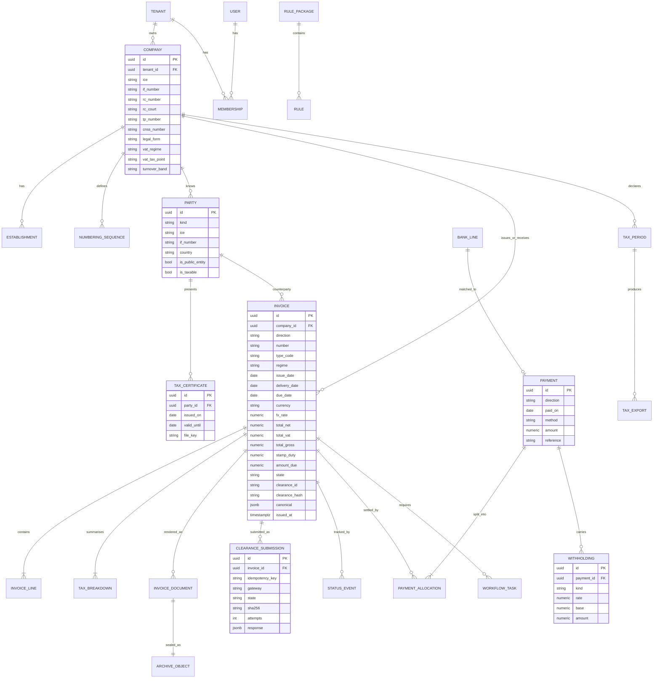

Rules:

- `tenant_id` on every table, enforced by RLS.
- `INVOICE.canonical` (JSONB) is the source of truth after issuance; typed columns are query projections.
- Database triggers block updates on issued invoices and on append-only tables (`STATUS_EVENT`, `CLEARANCE_SUBMISSION`, `AUDIT_LOG`).
- Number allocation happens inside the issuance transaction with a row lock: one unbroken sequence per series.
- Amounts `NUMERIC(18,2)`, unit prices `NUMERIC(18,6)`, quantities `NUMERIC(18,4)`, FX rates `NUMERIC(18,8)`.

---

## 8. Canonical invoice model

Based on the UBL 2.1 invoice and the EN 16931 semantic model, which is the common base of UBL-based mandates **[ANNOUNCED]** that Morocco follows it; the Moroccan profile is not published.

| Block | Content | Moroccan specifics |
|---|---|---|
| Header | Number, issue date, type (invoice, credit note, deposit, corrective), currency, due date, references (order, delivery note, contract) | Delivery date drives the law 69-21 clock |
| Seller | Name, legal form, capital, address, **ICE, IF, RC + court, TP, CNSS** | All five identifiers stored separately |
| Buyer | Name, address, **ICE**, IF when known, country, type (business, public, consumer, foreign) | ICE mandatory for Moroccan businesses |
| Lines | Item, quantity, unit, unit price, discount, VAT category and rate, exemption code | |
| VAT breakdown | Per rate: taxable base, VAT | Computed on the sum per rate, rounded to 2 decimals |
| Totals | Net, VAT, gross, stamp duty, deposits already paid, amount due | Stamp duty line when settled in cash |
| Withholding (informative) | Expected VAT withholding and net to pay | Final amount fixed at payment (section 12) |
| Payment | Method, bank details (RIB, 24 digits), term, late-payment clause | |
| Notes | Amount in words (FR / AR), legal notes, exemption reference | |
| Clearance | Identifier, hash, QR payload, timestamp | Filled after DGI validation **[ANNOUNCED]** |
| Attachments | Delivery notes, timesheets, contract | |

Identifier validation:

| Identifier | Check |
|---|---|
| ICE | 15 digits; structure 9 + 4 + 2; check-digit algorithm **[V]**; optional lookup on the official ICE service **[V]** |
| IF | Numeric; format **[V]** |
| RC | Number + court code from a reference list |
| RIB | 24 digits with key validation |

---

## 9. Operation classification

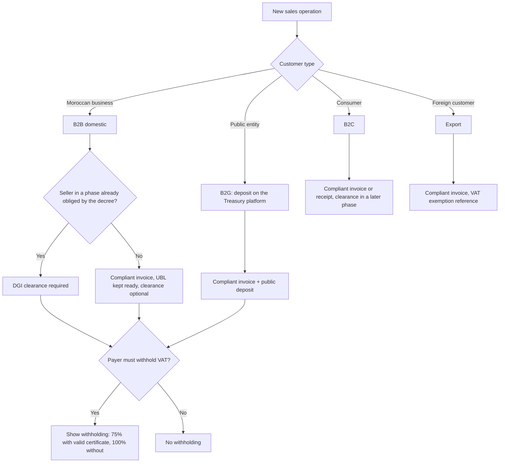

The classifier is a pure function of (seller profile, buyer profile, operation, date, active rule package). Its output is stored on the invoice: `regime`, `clearance_required`, `withholding_expected`, `stamp_duty_applicable`, `legal_payment_term_days`.

---

## 10. Sales invoices

### 10.1 States

`DRAFT` -> `VALIDATED` -> `ISSUED` (numbered, immutable) -> clearance and commercial statuses (section 11).

### 10.2 Issuance and clearance sequence

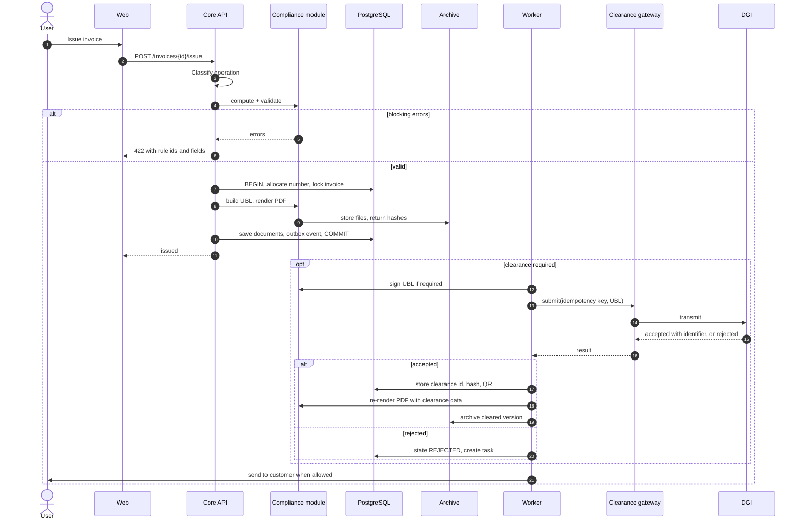

### 10.3 Validation layers

| # | Layer | Blocks issuance |
|---|---|---|
| 1 | Form and schema | Yes |
| 2 | Mandatory mentions (section 2.1) and identifier checks | Yes |
| 3 | Calculation consistency: lines, VAT per rate, totals, rounding | Yes |
| 4 | Duplicate: number + seller + fiscal year | Yes |
| 5 | Tenant business rules | Configurable |
| 6 | UBL 2.1 XSD | Yes when clearance is required |
| 7 | DGI profile rules, when published | Yes when clearance is required |
| 8 | Warnings: customer ICE missing, certificate expired, term above legal maximum | No, but recorded |

### 10.4 Requirements

- Types: invoice, credit note, deposit invoice, final invoice, progress billing (situation de travaux), pro forma (not numbered in the legal series), recurring.
- Series per company, year, type and establishment; the number is consumed only at issuance.
- Bilingual output: French, Arabic or both on the same document; amount in words generated in both languages.
- Delivery: email, WhatsApp or SMS link, customer portal, download; if the DGI delivers the cleared invoice itself, ours becomes a courtesy copy.
- Credit note always references the original; a rejected or cleared invoice is never edited.
- Bulk issuance and import by CSV or API.

---

## 11. Status model

Two tracks per invoice, kept separate.

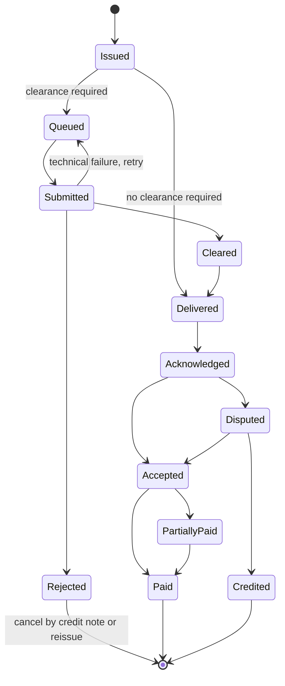

- **Clearance track** (`Queued`, `Submitted`, `Cleared`, `Rejected`): driven by the gateway. Names are ours; a mapping table translates DGI codes once known **[ANNOUNCED]**.
- **Commercial track** (`Delivered` to `Paid`): driven by the buyer's actions and by payments; it exists today regardless of the mandate.
- Every transition is an append-only `STATUS_EVENT` with source, timestamp and payload.
- A derived flag `overdue` is computed from due date and payment state for law 69-21.

---

## 12. Tax engine

### 12.1 VAT tax point

| Company option | VAT becomes due | Data needed |
|---|---|---|
| Receipts (default) | On each receipt, proportionally | Receipt date, amount, allocation per invoice and per VAT rate |
| Debits (option) | At invoicing | Issue date |

For each VAT period the engine produces VAT collected (by rate) and VAT deductible (by rate, on paid purchase invoices), each figure traceable to invoices and payments.

### 12.2 Withholding of VAT at payment

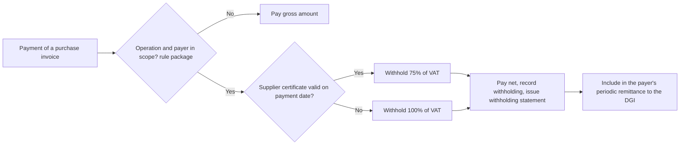

- Certificates (attestation de régularité fiscale) are stored per supplier with validity dates; expiry alerts go to both sides.
- On the sales side the app predicts the withholding the customer will apply, so the expected cash amount is right and the withheld VAT is tracked as a tax credit.
- Scope, rates and thresholds come from the rule package **[V]**.

### 12.3 Stamp duty

When an invoice is settled in cash, the stamp duty line (0.25% **[V]**) is computed and shown; cash payments above the deductibility caps raise a warning **[V]**.

### 12.4 Tax exports

| Export | Content | Format |
|---|---|---|
| VAT deduction statement (relevé de déductions) | Purchase invoices of the period with supplier IF and ICE, invoice number and date, net, VAT, rate, payment date and method | File accepted by SIMPL-TVA **[V]** schema |
| VAT preparation sheet | Collected and deductible VAT by rate, with drill-down | PDF, CSV |
| Withholding remittance statement | Withholdings operated in the period by supplier | CSV **[V]** official layout |
| Annual customer and supplier statements | Totals per counterparty with identifiers | CSV **[V]** official layout |
| Sales and purchase journals | Coded entries | CSV, formats of the main accounting packages |

---

## 13. Payment terms engine (law 69-21)

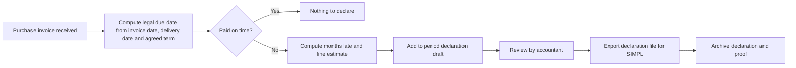

Requirements:

- Due-date calculator driven by the rule package: default term, maximum agreed term, sector exceptions, late-invoicing rule **[V]**.
- Ageing dashboard for payables with "days to legal limit" and projected fine.
- Declaration draft per period (quarterly or annual by turnover band **[V]**): invoices unpaid or paid late, amounts, dates, computed fine.
- Disputed invoices are flagged with their evidence, since litigation affects the treatment **[V]**.
- Mirror view on the sales side: customers who pay late, used for dunning.

---

## 14. Purchase invoices

Until buyers receive cleared structured invoices from the DGI, most supplier invoices arrive as PDF or paper. Capture quality is therefore a core feature, not an edge case.

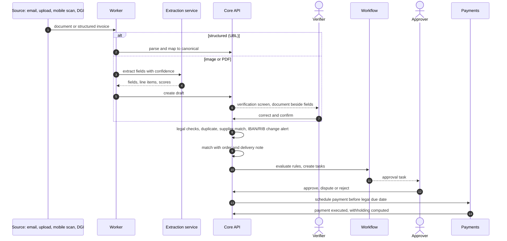

Requirements:

- Sources: dedicated mailbox per company, drag-and-drop, mobile camera, API, and the DGI channel when it exists.
- Extraction of header, totals, VAT lines, identifiers (ICE, IF), RIB, line items; Arabic and French documents; confidence per field.
- Verification screen ("vidéocodage"): document on one side, fields on the other, low-confidence fields highlighted, keyboard-first.
- Legal checks: mandatory mentions present, ICE valid, arithmetic consistent, duplicate detection.
- Supplier matching by ICE, IF, RIB; a changed RIB raises a fraud alert and blocks payment until confirmed.
- Three-way matching with tolerances.
- Scanned originals are stored as received with hash and timestamp. Whether the paper original may be destroyed is a legal question **[V]**; the default guidance is to keep it.

---

## 15. Payments and reconciliation

- Receipts and payments are records with allocations to one or more invoices; partial payments, advances, refunds, write-offs.
- Methods: transfer, cheque, bill of exchange (LCN / effet), cash, card, direct debit. Cheques and bills carry number, bank and due date, with states (received, deposited, cleared, returned).
- Bank statements: file import (CSV, MT940, CAMT.053) per bank; automatic matching by amount, reference and counterparty, with a confidence score. Direct bank connections where a bank offers an API **[V]**.
- Outgoing: payment batch file in the format accepted by the customer's bank **[V]**; remittance advice to the supplier.
- Online collection through a Moroccan payment gateway is optional.
- Each confirmed movement feeds the VAT tax point, withholding and payment-terms engines.

---

## 16. DGI clearance gateway

```ts
interface ClearanceGateway {
  submit(input: {
    idempotencyKey: string;
    companyId: string;
    ubl: Buffer;
    sha256: string;
    documentType: 'INVOICE' | 'CREDIT_NOTE';
  }): Promise<SubmissionReceipt>;

  getResult(receipt: SubmissionReceipt): Promise<
    | { state: 'PENDING' }
    | { state: 'CLEARED'; clearanceId: string; hash?: string; qr?: string; clearedAt: string; raw: unknown }
    | { state: 'REJECTED'; errors: { code: string; message: string; path?: string }[]; raw: unknown }
  >;

  fetchInbound(cursor?: string): Promise<Page<InboundInvoice>>;
  sendBuyerStatus(clearanceId: string, status: BuyerStatus, reason?: string): Promise<void>;
  reportPayment(clearanceId: string, payment: PaymentReport): Promise<void>;
  health(): Promise<'UP' | 'DEGRADED' | 'DOWN'>;
}
```

| Implementation | Purpose |
|---|---|
| `SimulatorGateway` | Development, tests, demos, customer sandbox. Configurable latency, rejection scenarios, outages |
| `DgiDirectGateway` | The DGI's system-to-system channel, written when the specification is published |
| `ProviderGateway` | Through a certified service provider, if that route is faster or required |

Reliability: outbox + idempotency key; exponential backoff; circuit breaker; contingency queue with proof of attempts when the platform is down; nightly reconciliation between our records and the platform's.

Onboarding of a company on the DGI platform (credentials, certificates, delegation to us as software provider) is unknown **[ANNOUNCED]**; the data model stores per-company gateway credentials encrypted with per-tenant keys.

---

## 17. Workflow and rules

- Rule engine: conditions on any canonical field, matching result or party attribute; actions route, require approval, block, enrich. Rules are JSON, versioned, testable on sample invoices before activation.
- Queues by role or team, with counts, ageing and SLA linked to the legal due date.
- Tasks: assign, delegate, comment, attach, escalate.
- Approval chains by amount; four-eyes rule on payments and on supplier bank details.
- Two kinds of rule packages: **regulatory** (maintained by us, effective-dated) and **tenant** (maintained by the customer).

---

## 18. Archive and audit trail

| Requirement | Design |
|---|---|
| Retention | 10 years **[LAW]**, configurable upward |
| Content | Issued PDF, UBL, cleared version, DGI responses, received originals, statuses, payments proof, tax exports and declarations |
| Integrity | SHA-256 per object; daily hash chain per tenant; qualified timestamp from an approved Moroccan provider when available |
| Immutability | Object lock, retention set at write |
| Encryption | Per-tenant data keys, envelope encryption |
| Retrieval | By number, counterparty, ICE, date, amount |
| Tax audit export | Zip per period: documents, index, integrity proof |
| Reversibility | Full export on termination |
| Audit log | Append-only, hash-chained: who, what, when, from where |

---

## 19. Security, privacy, hosting

| Area | Requirement |
|---|---|
| Authentication | MFA mandatory for issuing, approving, paying; passkeys; SSO for larger tenants |
| Authorization | RBAC scoped per company; RLS in the database |
| Roles | Owner, Admin, Accountant, Billing, Buyer, Verifier, Approver, Payer, Auditor, External accountant, API client |
| Accounting firms | One login, portfolio of client companies, per-client permissions, activity log visible to the client |
| Segregation of duties | Creating or changing a supplier's RIB and approving its payment are separate people |
| Personal data | Law 09-08: CNDP formalities before launch; data-processing agreements; no transfer abroad without authorisation **[V]** |
| Hosting | Primary region in Morocco when a suitable provider is available; otherwise EU with CNDP transfer authorisation. Customers in regulated or public sectors may require Moroccan hosting **[V]** |
| Sub-processors | Extraction, email and messaging providers reviewed for data location; extraction can run in-region |
| Application security | OWASP ASVS level 2, dependency and container scanning, yearly penetration test |
| Backups | Encrypted, restore tested quarterly, second site |

---

## 20. Non-functional requirements

| Item | Target |
|---|---|
| Availability | 99.9% monthly |
| Issuance | p95 under 3 s to "issued" |
| Clearance handover | p95 under 60 s after issuance, alert at 15 min |
| Extraction | 90% of documents ready for verification under 60 s |
| RPO / RTO | 5 min / 1 h |
| Connectivity | UI usable on slow mobile networks; drafts saved locally and synchronised |
| Languages | French, Arabic (RTL), English |
| Accessibility | WCAG 2.1 AA |
| Scale | 50 invoices/s in bulk, workers scale horizontally |

---

## 21. Testing

| Level | Content |
|---|---|
| Unit | Calculator, classifier, due dates, withholding, VAT tax point, number-to-words FR/AR: table-driven and property-based |
| Rules | Each regulatory rule package ships with fixtures; a new version replays the corpus |
| Format | Every generated UBL validates against the UBL 2.1 XSD; DGI samples added when published |
| Contract | Gateway implementations against one shared test suite driven by the simulator |
| Integration | Testcontainers for Postgres and storage |
| End to end | Playwright in French and Arabic: issue, clear, receive, verify, approve, pay, export |
| Extraction | Labelled set of real Moroccan invoices, accuracy tracked per field |
| Security | Cross-tenant access tests, permission matrix tests |

---

## 22. Deployment

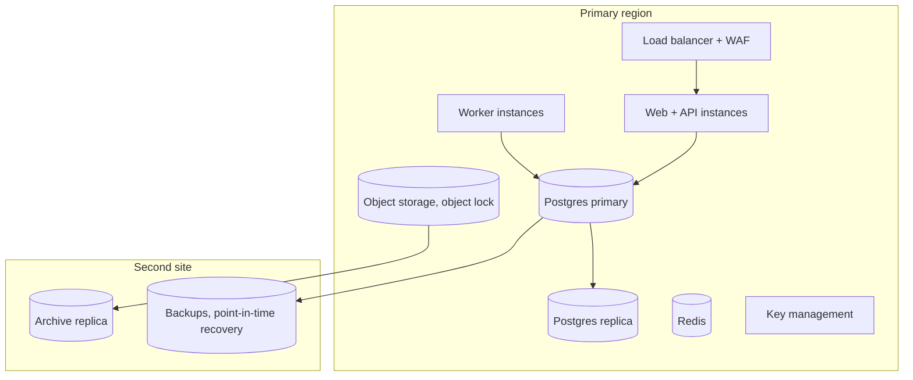

Environments: `dev`, `staging`, `sandbox` (customer-facing, simulator gateway), `production`.

---

## 23. Roadmap

Built so that value arrives before the mandate and the clearance work starts the day the specification is published.

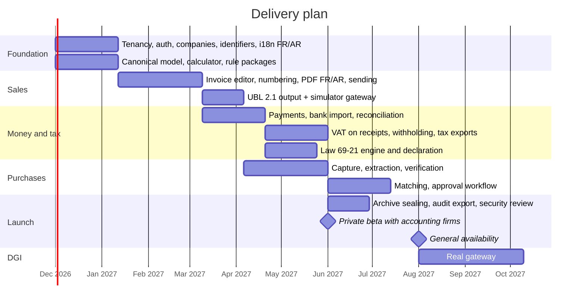

The DGI bar is a placeholder: its start is triggered by the publication of the specification, not by a date.

| Phase | Deliverable | Exit criterion |
|---|---|---|
| 1 | Legally complete invoice, FR/AR, numbered and archived | Reviewed by a Moroccan expert-comptable |
| 2 | Payments, VAT on receipts, withholding | VAT figures match a manual return on pilot data |
| 3 | Law 69-21 and tax exports | Files accepted by SIMPL on a pilot company |
| 4 | Purchases with extraction and workflow | Field accuracy target met on the labelled set |
| 5 | DGI clearance | Passes the DGI's qualification, when it exists |

---

## 24. Points to verify

Unpublished, awaiting the DGI:

| # | Point |
|---|---|
| 1 | Decree: dates, thresholds, scope by phase, penalties |
| 2 | Technical specification: UBL profile, code lists, validation rules, signature level, API, authentication, sandbox |
| 3 | Clearance outputs: identifier, hash, QR code, how they appear on the document |
| 4 | Delivery to the buyer, buyer statuses, payment reporting |
| 5 | Software or provider certification requirements, onboarding and delegation |
| 6 | Contingency procedure when the platform is unavailable |

Existing rules, to confirm with the official text or a Moroccan expert-comptable before coding:

| # | Point | Where |
|---|---|---|
| 7 | Exact list of mandatory mentions, status of CNSS and amount in words, penalty per omission | CGI art. 145, 198 ter; commercial code |
| 8 | VAT rates by product and service after the reform; exemption codes | CGI, 2026 edition; DGI circular for the 2026 finance law |
| 9 | Withholding of VAT: operations, payers, rates, certificate validity, remittance form | CGI art. 117; 2026 circular |
| 10 | Law 69-21: terms, fine formula, thresholds, periodicity for the 2-10 M MAD band, declaration layout | Law 69-21, DGI circular 734, DGI position D 326/26 |
| 11 | Stamp duty rate and cash-payment deductibility caps | CGI art. 11, 252 |
| 12 | SIMPL file layouts: deduction statement, withholding, annual statements | DGI SIMPL documentation |
| 13 | ICE check-digit algorithm and official lookup service | ICE portal |
| 14 | Public-sector deposit on the Treasury platform: who, how, API or portal | TGR documentation |
| 15 | Personal data: CNDP formalities, conditions for hosting abroad | Law 09-08, CNDP |
| 16 | Destruction of paper originals after scanning | CGI art. 211, accounting law 9-88 |
| 17 | Bank file formats and availability of bank APIs | Each bank |

**Recommendation:** have sections 2, 12 and 13 reviewed by a Moroccan expert-comptable before development of the tax engine. The sources available online are mostly vendor and firm blogs that contradict each other on thresholds and amounts.

---

## 25. Sources

Status of the mandate (all secondary; no official DGI text found):

- [Hisab: e-invoicing in Morocco, updated 1 Oct 2026](https://hisab.ma/en/docs/mandate-2026)
- [Manageo: where the reform stands, September 2026](https://www.manageo.io/blog/facturation-electronique-point-detape-septembre-2026/)
- [YanCommerce: e-invoicing guide for SMEs, checked October 2026](https://yancommerce.com/facturation-electronique-maroc)
- [Challenge: companies facing the switch](https://www.challenge.ma/facturation-electronique-les-entreprises-face-a-la-grande-bascule-320792/)
- [Comarch: Morocco confirms 2026 mandate, May 2026](https://www.comarch.com/trade-and-services/data-management/legal-regulation-changes/morocco-confirms-2026-mandate-for-electronic-invoicing/)
- [EDICOM: Morocco, UBL and CTC model, April 2026](https://edicomgroup.com/blog/morocco-electronic-invoicing)
- [RTC Suite: latest updates, May 2026](https://rtcsuite.com/morocco-e-invoicing-2026-latest-updates-ctc-model-and-how-businesses-should-prepare/)
- [DGI portal](https://www.tax.gov.ma)

Existing rules:

- [La Vie éco: ICE, mandatory mentions and penalties](https://www.lavieeco.com/affaires/factures-ice-mentions-obligatoires-et-sanctions/)
- [Upsilon Consulting: purchase documents, CGI art. 146](https://upsilon-consulting.com/pieces-justificatives-des-achats-article-146-du-cgi/)
- [Clicpaie: ICE structure](https://clicpaie.ma/blogs/ice-maroc/)
- [Deloitte: main measures of the 2026 finance law](https://blog.avocats.deloitte.fr/maroc-les-principales-mesures-de-la-loi-de-finances-pour-2026/)
- [Upsilon Consulting: VAT withholding guide 2026](https://upsilon-consulting.com/retenue-source-tva-maroc/)
- [Bladi: VAT withholding extended to the private sector](https://www.bladi.net/maroc-retenue-source-tva-arrive-qui-changer-entreprises,118973.html)
- [Upsilon Consulting: law 69-21](https://upsilon-consulting.com/loi-69-21-delais-paiement/)
- [Médias24: payment-terms declaration before 1 April 2026](https://medias24.com/2026/03/14/delais-de-paiement-declaration-obligatoire-avant-le-1er-avril-2026-1643453/)
- [Le Matin: what late payers face](https://lematin.ma/economie/delais-de-paiement-ce-qui-attend-les-entreprises-retardataires/196859)
- [Fiscamaroc: CGI art. 211](https://www.fiscamaroc.com/dispositions-communes-208/article-211-conservation-des-documents-comptables-316.htm)
- [CMS: data protection in Morocco](https://cms.law/en/int/expert-guides/cms-expert-guide-to-data-protection-and-cyber-security-laws/morocco)
- [Tamimi: electronic transactions in Morocco](https://turtl.tamimi.com/story/electronic-transactions-in-morocco/)
- [TelQuel: Barid Al-Maghrib qualified services](https://telquel.ma/sponsors/confiance-numerique-barid-al-maghrib-passe-a-lhorodatage-qualifie_1987210)

